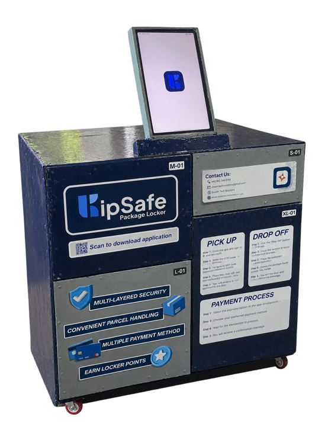
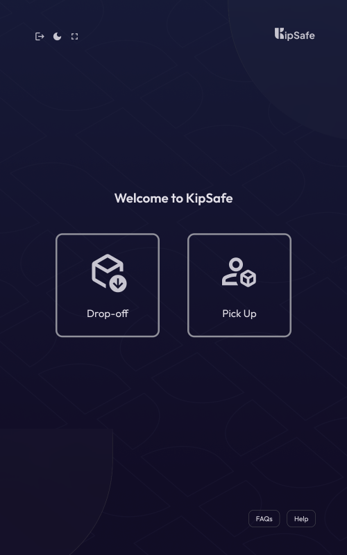
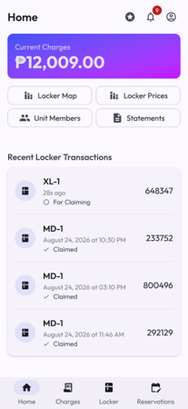
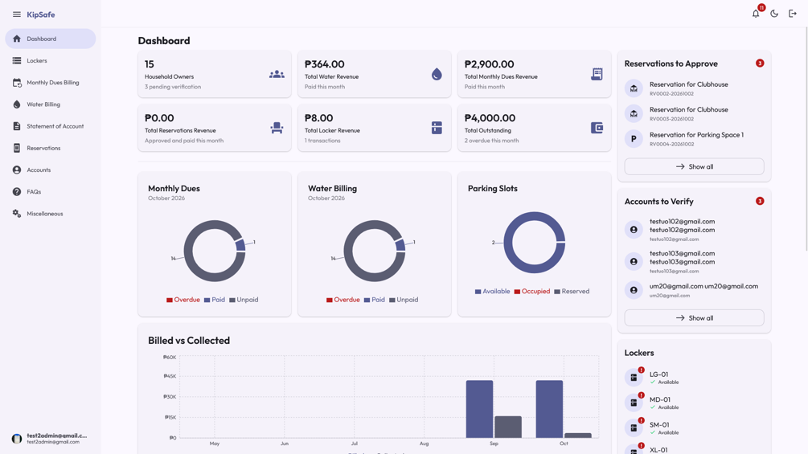

# KipSafe — A Condominium Management Web App with IoT-Based Package Locker for San Benissa Garden Villas

> [!NOTE]
> This repository contains project documentation, screenshots, and technical information. The application's source code is maintained in a private repository. Please [contact us](#source-code-availability) for inquiries regarding access, complete screenshots, and other concerns.

## Project Overview

**KipSafe** is a condominium management system accompanied by an IoT-based package locker developed specifically for San Benissa Garden Villas.

The system features integrated web, mobile, and kiosk applications tailored for four distinct user roles: Household Owner, Household Member, Administrator, and Delivery Rider.

KipSafe enables residents to receive deliveries securely even when they are unavailable to collect their parcels in person. Delivery riders can drop off packages into designated lockers, which then trigger the generation of a One-Time PIN (OTP) sent directly to the respective resident via the KipSafe mobile application. Residents subsequently use this OTP at the kiosk to open the locker and retrieve their items.

### Project Objectives

- Provide a secure and convenient parcel storage and retrieval process.
- Provide household owners and members with app to manage locker transactions, as well as to manage condominium tasks such as paying of monthly dues, water billing, and reservations.
- Provide administrators with tools to manage locker transactions, monthly dues, water billing, reservations, and other condominium-related processes.

### Intended Users

| User               | Description                                                                                                     |
| ------------------ | --------------------------------------------------------------------------------------------------------------- |
| Administrators     | Manage locker transactions, monthly dues, water billing, reservations, and other condominium-related processes. |
| Household Owners   | Manage their own locker transactions and condominium-related tasks.                                             |
| Household Members  | Manage locker transactions                                                                                      |
| Delivery Personnel | Interact with the locker kiosk during parcel delivery.                                                          |

## Key Features

### Secure Parcel Access

- OTP-based locker unlocking for authorized parcel retrieval.
- Integration between the web application and IoT locker hardware.
- Parcel transaction tracking and status management.

### Mobile Application

- Provides household owners and members with a mobile interface for condominium management and locker transactions.
- Allow users to receive notifications for parcel deliveries and locker access.
- Enable users to pay their monthly dues and water bills
- Make reservations for condominium amenities.
- Support for both Android and iOS devices.

### Account and Access Management

- Firebase Authentication integration.
- Role-based access control.
- Account verification and activation workflows.
- Administrative account management.

### Administrative Webapp

- Centralized management of locker transactions
- Allow admins to manage condominium-related tasks such as monthly dues, water billing, and reservations.
- Account approval and status management.
- Dashboard interfaces for administrative operations.

### Responsive Web Application

- Responsive interfaces for desktop and mobile devices.
- Progressive Web App (PWA) capabilities.
- Dedicated interfaces for different user roles.

## Technology Stack

### Frontend

| Technology           | Purpose                                         |
| -------------------- | ----------------------------------------------- |
| React                | Component-based user interface development      |
| TypeScript           | Static typing and maintainable application code |
| Vite                 | Development server and production build tooling |
| Tailwind CSS         | Responsive styling and interface design         |
| React Router         | Client-side navigation and routing              |
| TanStack React Query | Server-state management and caching             |
| Zustand              | Lightweight client-side state management        |
| Zod                  | Runtime data validation and schema definitions  |

### Backend and Cloud Services

| Technology                   | Purpose                                                                  |
| ---------------------------- | ------------------------------------------------------------------------ |
| Firebase Authentication      | User authentication and identity management                              |
| Cloud Firestore              | Cloud-hosted NoSQL database                                              |
| Cloud Functions for Firebase | Server-side application logic                                            |
| Firebase Cloud Messaging     | Push notification delivery                                               |
| Firebase Storage             | File and media storage                                                   |
| Node.js                      | Cloud Functions runtime                                                  |
| Realtime Database            | Communication between the locker itself, kiosk, and the Firebase backend |

### Development and Testing

| Technology              | Purpose                                   |
| ----------------------- | ----------------------------------------- |
| Git and GitHub          | Version control and collaboration         |
| GitHub Actions          | Continuous integration workflows          |
| Playwright              | End-to-end application testing            |
| Firebase Emulator Suite | Local development and integration testing |
| ESLint, Prettier        | Code quality and linting                  |
| TypeScript Compiler     | Static type checking                      |

## System Screenshots

The following screenshots demonstrate selected features and interfaces of the KipSafe system. Not all screenshots are provided due to confidentiality and privacy considerations.

### Locker hardware prototype

### Kiosk interface

### Mobile application interface

### Admin dashboard interface

## Source Code Availability

This repository serves as a public showcase of the KipSafe project.

The complete source code is maintained in a private repository to protect project-specific implementation details, configurations, and other non-public resources.

For inquiries about the project, its implementation, and others, feel free to contact us:

- **Icermi Ribano** (Hardware Engineer): ribanoib@students.nu-fairview.edu.ph
- **Josh Andre Dela Cruz** (Hardware Engineer): delacruzjs@students.nu-fairview.edu.ph
- **Vince Warren Taule** (Full-Stack Developer): taulevt@students.nu-fairview.edu.ph, vincewarrentaule@gmail.com, scoofszlo@gmail.com
- **Adrian Jamil Flores** (Documentation Maintainer, UI/UX Designer): floresaj@students.nu-fairview.edu.ph
- **John Aaron Hernandez** (Project Manager): hernandezje1@students.nu-fairview.edu.ph

---

_This repository is maintained for project documentation and portfolio presentation purposes._
